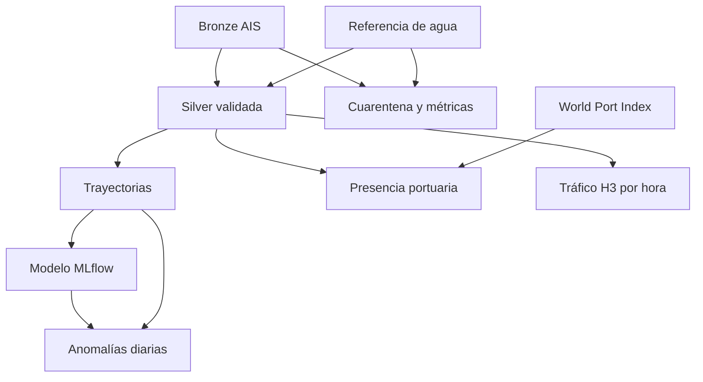

# Contrato de datos de OceanWatch

**Versión 2.0 · Equipo 8 · Entrega 2 de Sistemas Intensivos de Datos.** El catálogo institucional es `dbr_acad_ingsistemas_mine` y el esquema de consumo es `oceanwatch_oro_eq8`. En Free Edition el catálogo vinculado es `oceanwatch_externo` y el esquema compartido es `oro`. Ambas ubicaciones exponen los mismos nombres de tabla. El responsable operativo es `mine-group8`.

Los productos son tablas Delta administradas y particionadas por `fecha`. Una fecha representa el día UTC del evento. La hora de programación del job se expresa en America/Bogota. La disponibilidad de la consola se evalúa tras la finalización de 05. Un reintento sustituye la partición afectada. Cada tabla tiene su propia transacción Delta. El historial y los controles de publicación permiten reconstruir qué ocurrió si se interrumpe una tarea.

## Productos

| Tabla | Llave y unidad | Fuente directa | Consumidor |
| --- | --- | --- | --- |
| `oceanwatch_gold_trayectorias` | `fecha, MMSI` · un buque al día | Silver v2 | KPI de buques y modelo de velocidad |
| `oceanwatch_gold_presencia_puertos` | `fecha, numero_puerto, MMSI` · presencia observada | Silver v2 y World Port Index | Ranking y lista de buques |
| `oceanwatch_gold_trafico_celda_hora` | `fecha, hora, h3_cell` · celda H3 y hora UTC | Silver v2 | Mapa de intensidad |
| `oceanwatch_gold_anomalias` | `fecha, MMSI` · evaluación diaria | Trayectorias, historial anterior y versión MLflow | Cobertura, alertas y trazabilidad |

## Diccionario

`fecha DATE` y `MMSI STRING` (cuando se usa) son obligatorios. MMSI conserva los nueve dígitos, incluidos ceros iniciales. Los campos marcados como obligatorios son invariantes de la transformación y de los controles de calidad. Las tablas Delta admiten nulos físicamente salvo que se indique en un DDL.

| En trayectorias | Tipo | Significado y regla |
| --- | --- | --- |
| `n_posiciones` | BIGINT | Mensajes admitidos por buque y día, mínimo uno. |
| `inicio`, `fin` | TIMESTAMP | Primera y última señal del día, UTC. La última es igual o posterior a la primera. |
| `lat_inicio`, `lon_inicio`, `lat_fin`, `lon_fin` | DOUBLE | Coordenadas WGS84 en grados de esas dos observaciones. |
| `distancia_km` | DOUBLE | Suma de tramos consecutivos en el día por haversine, radio terrestre 6.371 km. Una observación da cero. Se conserva el salto observado entre mensajes aun si son distantes en el tiempo. |
| `sog_media` | DOUBLE | Media aritmética de SOG por mensaje válido, en nudos. No se pondera por duración. |

| En presencia portuaria | Tipo | Significado y regla |
| --- | --- | --- |
| `numero_puerto` | INT | Identificador WPI del puerto. Distingue puertos homónimos. |
| `puerto`, `pais` | STRING | Nombre y país publicados por el WPI. El campo fuente `Country Code` contiene nombres de país en el CSV del equipo. |
| `n_posiciones` | BIGINT | Mensajes del buque en la celda H3 de resolución 7 del puerto o en su primer anillo. Mínimo uno. |
| `inicio`, `fin` | TIMESTAMP | Primera y última observación del buque en esa vecindad durante el día. El intervalo puede contener salidas y regresos. |

Un mensaje puede coincidir con dos puertos próximos. Cada WPI cuenta al buque una sola vez al construir el ranking diario. Sumar conteos de varios puertos puede duplicar buques. Esta aproximación indica presencia observada durante la fecha consultada. Un atraque, un arribo formal y la ocupación en tiempo real requieren otra definición y otras evidencias.

| En tráfico | Tipo | Significado y regla |
| --- | --- | --- |
| `hora` | INT | Hora de la señal en UTC, 0 a 23. |
| `h3_cell` | STRING | ID hexadecimal de la celda H3 resolución 8. Se calcula con longitud primero y latitud después. |
| `n_posiciones` | BIGINT | Total de posiciones en la celda y hora, mínimo uno. Es aditivo entre celdas y horas. |
| `n_buques` | BIGINT | MMSI distintos dentro de la celda y hora. Entre uno y `n_posiciones`. Un buque puede aparecer en varias horas o celdas. |

El mapa suma mensajes entre horas por celda y representa hasta las 3.000 celdas más activas del día, con desempate por ID. La intensidad es cantidad de mensajes. El KPI de buques únicos procede de trayectorias para conservar su unidad.

| En anomalías | Tipo | Significado y regla |
| --- | --- | --- |
| `n_posiciones`, `sog_media` | BIGINT, DOUBLE | Cobertura y velocidad media del buque-día. SOG en nudos. |
| `velocidad_tramos` | DOUBLE, admite nulo | Distancia en km dividida entre 1,852 y las horas entre primera y última señal. Incluye pausas. Mínimo dos posiciones y diez minutos de observación. |
| `brecha` | DOUBLE, admite nulo | Diferencia absoluta entre la SOG media y la velocidad por tramos, en nudos. |
| `score` | DOUBLE, admite nulo | Opuesto de la función de decisión de Isolation Forest. Un valor mayor indica mayor rareza. |
| `es_anomalia` | BOOLEAN, admite nulo | Verdadero si el score es positivo. Queda nulo cuando no se evaluó el buque. |
| `estado` | STRING | `evaluado`, `traza_insuficiente` o `sin_historial`. |
| `modelo_version`, `run_id` | STRING, admiten nulo | Versión exacta de Registry y run de entrenamiento. Nulos cuando ese día aún carece de modelo. |

Se evalúan anomalías de velocidad dentro de las posiciones aceptadas. Las infracciones de calidad de un mensaje AIS se conservan por separado en cuarentena. Sin verdad de terreno, el porcentaje de alertas y la coincidencia con el percentil 99 del histórico describen el comportamiento del detector.

## Calidad, periodicidad y evolución

- Bronze recibe el CSV histórico diario mediante Auto Loader, conserva la procedencia y acepta solo apéndices. La publicación de cada archivo termina antes del arranque de Bronze. Se admite una sola ejecución concurrente.
- Silver evalúa todas las copias antes de elegir una válida por `MMSI, BaseDateTime`. Se prioriza por procedencia y contenido dentro del lote. Una versión válida confirmada en un lote anterior queda como registro canónico. Se registra el balance de cada microbatch y se preserva cada rechazo con sus causas.
- Las coordenadas deben corresponder a una celda con agua cartografiada. La rejilla de 0,005° usa tierra, lagos y cauces de Natural Earth, costa estadounidense TIGER/Line 2023 y la National Waterway Network de USACE. Una celda atravesada por una línea costera o navegable se admite. Su diagonal alcanza unos 790 m en el ecuador. Los canales omitidos y los muelles cerca de una orilla introducen incertidumbre. La máscara se usa para control analítico. La procedencia y las huellas están en `reference/fuentes.md`.
- En 04 el marcador `oceanwatch_control_oro_v2` se confirma tras las tres escrituras. Una llegada tardía en Silver vuelve a abrir el día afectado hasta la fecha pedida. En 05 la firma de las revisiones de los últimos 14 días y del día puntuado identifica qué resultados de ML requieren actualización.
- El job diario a las 06:00 de Bogotá hace un replay del archivo histórico. La primera fecha del replay automático es 2023-06-08. El parámetro explícito sirve para un backfill. Registrar la duración en Runs, según el cómputo y el corpus usados.
- Una columna opcional nueva necesita descripción y una prueba de compatibilidad de los dos tableros. Un cambio en llave, unidad, esquema estructural o definición del score requiere una versión mayor y reprocesamiento explícito.

## Permisos y linaje

| Identidad | Alcance | Privilegios |
| --- | --- | --- |
| Operador del job / `mine-group8` | Preparación, volumen, tablas de proceso y oro, modelo | Uso de catálogo/esquemas, lectura y escritura del volumen, SELECT/MODIFY operativos. CREATE MODEL en oro y propiedad o gestión autorizada para registrar y mantener versiones. |
| Grupo analítico institucional existente | Catálogo, esquema de oro y sus cuatro tablas | USE CATALOG, USE SCHEMA y SELECT en cada producto. El propietario indica el principal real en `grupo_lectura`. Para el tablero publicado con credenciales del lector se requiere también CAN VIEW en el tablero y CAN USE en el warehouse. |
| Destinatario `oceanwatch_eq8_free` | Share de las cuatro tablas | SELECT ON SHARE. El perfil vincula un catálogo en el workspace receptor. |

Revisar grants heredados al demostrar solo lectura. Un integrante que además pertenece a ingeniería puede tener permisos adicionales. Las cuentas individuales del setup original se conservan para la operación del equipo.

El modo `verificar` consulta el linaje observado en `system.access.table_lineage`. Si la universidad limita esa tabla, abrir **Catalog Explorer → tabla → Lineage**. El modelo se rastrea por `modelo_version`, `run_id`, firma de la muestra y datos de entrada registrados en MLflow. El diagrama documenta las dependencias previstas.

## Controles de aceptación

El modo `verificar` compara para la fecha elegida los conteos de Silver con la suma de `n_posiciones` en trayectorias y tráfico. Verifica la unicidad de las cuatro llaves, el balance de Silver y la cobertura del producto ML. El bono compara conteo y suma decimal de hashes de filas de cada tabla entre dos hosts diferentes. Las huellas se calculan en UTC sobre las columnas en el orden del contrato.

## Fuentes

- NOAA Marine Cadastre. [Vessel Traffic](https://hub.marinecadastre.gov/pages/vesseltraffic) y [archivo diario 2023 utilizado por el equipo](https://coast.noaa.gov/htdata/CMSP/AISDataHandler/2023/index.html).
- NGA. World Port Index incluido en el repositorio como `UpdatedPub150.csv`. [World Port Index](https://msi.nga.mil/Publications/WPI).
- Databricks. [Model Registry en Unity Catalog](https://docs.databricks.com/aws/en/machine-learning/manage-model-lifecycle), [dashboards AI/BI](https://docs.databricks.com/aws/en/dashboards/) e [instalación de un proveedor Open Sharing](https://docs.databricks.com/aws/en/opensharing/read-data-open-databricks).
